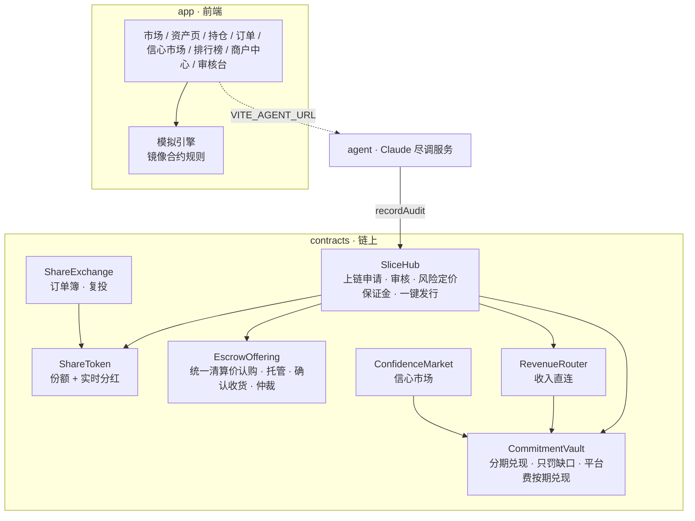

# Slice · 全球生意交易所

用 USDT 买下世界上任何一门生意的一片：洛杉矶的酒吧股权、首尔一首歌的版税、肯尼亚太阳能电站的电费收入。

- **担保交易**：USDT 锁在托管合约里，商户完成工商变更、投资人确认收货才放款；流拍或商户违约全额退回。
- **不拼手速的认购**：统一清算价拍卖，所有人按同一个价格成交，超额认购按比例配售；截止前 48 小时禁止撤单。
- **AI 尽调**：Claude Agent 交叉核验工商库、证件、Google 地图、社媒和银行流水，给出信任分、风险点，并替投资人先提问。
- **公开问答**：任何人都能向老板提问，72 小时内必须公开回答，答完才能开启认购。
- **押了保证金的分红承诺**：保证金倍数由 AI 信任分和违约记录决定；可以分期付款；违约只罚缺口，自动赔给持有人，永久记录在链上。
- **收入直连**：版税、App 分成、电费这类收入直接打进路由合约，按比例自动兑现承诺，不经过商户。
- **平台和投资人同一条船**：3% 平台费里 2% 锁在金库，按时兑现一期才释放一份，违约那份归持有人。
- **信心市场**：Polymarket 式的“会不会按时分红”市场，直接读取链上记录结算，无需预言机。
- **链上订单簿**：挂单期间份额照拿分红；分红一键（或自动）复投。
- **排行榜**：先知榜、尽调猎人榜、收租榜，只奖励猜得准、问得好、真收到分红的人。

完整产品逻辑见 [docs/PRODUCT.md](docs/PRODUCT.md)；在这里干活之前先读 [CLAUDE.md](CLAUDE.md)（原则、攻击者清单、完成的定义、待办）。

> 演示中的生意、人物和数字均为虚构；资金为测试网模拟 USDT。

---

## 目录

```
slice/
├── app/        前端（Vite + React + TypeScript），内置一个与合约规则一致的模拟引擎，构建成单个 HTML 文件
├── contracts/  Solidity 合约（Foundry），58 个测试
├── agent/      AI 尽调服务（Claude + 网页搜索 + Google Places + 工商库 + 流水取证）
└── docs/       产品文档
```



---

## 快速开始

需要 Node 20+。

### 前端

```bash
cd slice/app
npm install
npm run dev          # http://localhost:5173
npm run build        # dist/index.html 是可以直接部署的单文件
npm test             # 引擎测试：清算价、按比例配售、分期与罚没、平台费、分红、撮合、信心市场、排行榜与合约结果一致，模拟 400 天不变量
```

打开后点“开始逛逛”。演示钱包里已有 2,500 测试 USDT、两笔持仓和一笔待确认收货的订单。右上角的 **+7天** 或“我的 → 时间机器”可以快进时间，看完认购截止、交割、自动确认、季度分红和违约罚没的完整周期。

在“商户中心”可以把自己的生意走一遍完整上链流程；在“审核台”扮演平台核验登记和处理仲裁。

### 合约

需要 [Foundry](https://book.getfoundry.sh/getting-started/installation)。

```bash
cd slice/contracts
git submodule update --init --recursive
forge test           # 58 个测试：完整生命周期、统一清算价拍卖、托管与仲裁、分期与罚没、平台费按期兑现、收入直连、信心市场、订单簿与复投、模糊测试
```

部署到任意 EVM 链（测试网不填 `USDT` 会自动部署带水龙头的 MockUSDT）：

```bash
forge script script/Deploy.s.sol --rpc-url $RPC_URL --private-key $PRIVATE_KEY --broadcast
# 本地演示：anvil &  然后加 SEED_DEMO=true，会顺带上架一个示例资产
```

### AI 尽调服务

```bash
cd slice/agent
npm install
cp .env.example .env     # 填 ANTHROPIC_API_KEY；GOOGLE_MAPS_API_KEY、OPENCORPORATES_API_TOKEN 可选
npm run audit -- examples/neon-coyote-bar.json --docs statements.pdf   # 命令行跑一次尽调
npm start                # http://localhost:8787  POST /api/audit 以 SSE 流式返回进度和报告
npm test
```

让前端连上真实 Agent：

```bash
cd slice/app
VITE_AGENT_URL=http://localhost:8787 npm run dev
```

商户中心第 4 步就会实时显示 Agent 的搜索、工具调用和推理过程。加 `--publish --asset <id>` 并配置 `RPC_URL / VERIFIER_PRIVATE_KEY / SLICE_HUB`，Agent 会把信任分和报告哈希写进 `SliceHub.recordAudit`。

模型使用 `claude-opus-5-5`，开启了服务端 `fallbacks: "default"`：如果请求被安全分类器拒绝，会自动切换到推荐的备用模型重试。

---

## 部署

- **GitHub Pages**：`.github/workflows/slice-pages.yml` 在推送到 `main` 时构建 `slice/app` 并发布。需要在仓库 Settings → Pages 把 Source 设为 “GitHub Actions”。
- **任意静态托管**：`slice/app/dist/index.html` 是单个文件，React 从 cdnjs 加载，直接上传即可。
- **CI**：`.github/workflows/slice-ci.yml` 跑合约测试、Agent 类型检查与测试、前端构建与测试。

---

## 合约一览

| 合约 | 作用 |
|---|---|
| `SliceHub` | 商户提交申请（文件指纹上链）→ 审核员/AI 写入信任分 → 按信任分和违约记录要求保证金倍数 → 商户一键发行（克隆下面的合约，并把保证金直接存入金库） |
| `ShareToken` | 每个资产的份额代币；按“每股累计分红”记账，转账不影响已赚分红；交易所只能锁定、不能转走挂单份额；可选 `compliance` 转账检查（KYC/地区规则） |
| `EscrowOffering` | 统一清算价认购（价格阶梯、按比例配售、取回未成交）、截止前 48 小时禁止撤单、成团/流拍、商户签约、审核员核验登记、确认收货、自动确认、押 2% 仲裁、平台 14 天不裁决自助退款、退款 |
| `CommitmentVault` | 分红承诺：保证金、随时分期付款、宽限期后任何人可罚没（只罚缺口）、平台费按期兑现、提高承诺需先补保证金 |
| `RevenueRouter` | 收入直连：第三方付款进合约，`flush()` 按固定比例拆给金库（持有人）和商户，无管理员 |
| `ConfidenceMarket` | 奖池式“会/不会按时分红”市场，直接读 `CommitmentVault` 结算；禁止商户下注 |
| `ShareExchange` | 链上限价订单簿 + 市价买卖，价格优先、时间优先，吃单 0.5%；`reinvest` 一笔交易领分红并复投 |
| `MockUSDT` | 测试网 USDT（6 位小数，带水龙头） |
