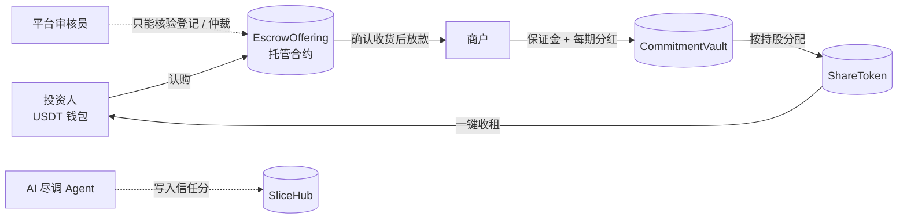

# Slice 产品逻辑

> 用 USDT，买下世界上任何一门生意的一片。

这份文档是产品规格：每一条规则都对应仓库里一段已测试的代码（合约、AI Agent 或前端引擎）。演示里的所有生意、人物和数字都是虚构的。

---

## 1. 一句话定位

**全世界长尾生意的“担保交易 + 交易所”**。东京的上班族可以用 $50 USDT 买洛杉矶一家酒吧 0.005% 的股权，每季度收到分红；首尔的独立歌手可以把一首歌未来 5 年一半的版税卖给全世界的歌迷。

和预测市场、加密交易所一样即开即用，但卖的是**真实现金流**。所以产品的核心任务是消除信任成本：

| 投资人的担心 | 产品给出的答案 | 代码位置 |
|---|---|---|
| 钱付了，老板跑了怎么办？ | 钱先锁进托管合约，商户完成工商变更、你确认收货才放款 | `EscrowOffering.sol` |
| 这个生意是真的吗？ | AI 尽调：工商库、证件、Google 地图、社媒、银行流水交叉核验 | `slice/agent` |
| 老板说的话靠谱吗？ | 公开问答：任何人都能提问，老板 72 小时内必须公开回答，回答归档进发行文件 | 前端 `QA` + 发行文件 |
| 承诺的分红会不会只是嘴上说说？ | 每一期分红都押了保证金，违约自动罚没赔给持有人 | `CommitmentVault.sol` |
| 我怎么知道它会不会违约？ | 信心市场：全世界投资人用真金白银给出违约概率 | `ConfidenceMarket.sol` |
| 想卖了怎么办？ | 链上订单簿，挂单期间照样拿分红 | `ShareExchange.sol` + `ShareToken.sol` |

---

## 2. 三个角色，资金不经过平台



- **投资人**：认购、确认收货、交易、领分红、提问、在信心市场下注。
- **商户**：提交材料、回答问题、设定条款、存保证金、签约、做工商变更、按期付分红。
- **平台**：只做两件事——核验登记变更（`attestRegistration`）和仲裁（`resolveDispute`）。平台碰不到托管资金，也不能替任何人确认收货。

---

## 3. 商户上链的 7 步

| 步骤 | 商户做什么 | 系统做什么 | 合约 |
|---|---|---|---|
| 1. 提交申请 | 填生意信息、上传工商/证件/流水/许可 | 文件在浏览器算 SHA-256，指纹上链存证 | `SliceHub.submitAsset` |
| 2. AI 尽调 | — | Agent 查工商库、Google 地图、社媒、新闻，对流水做取证，给出 0–100 信任分和风险点 | `SliceHub.recordAudit` |
| 3. 公开问答 | 回答 AI 和投资人的所有问题，按要求补材料 | 72 小时回答时限；未回答完不能开启认购 | 前端规则 |
| 4. 开启认购 | 设定条款、存入保证金 | 克隆 ShareToken + EscrowOffering + CommitmentVault | `SliceHub.launch` |
| 5. 认购期 | — | USDT 锁入托管；投资人可随时取消（冷静期）；到期或售罄后成团/流拍 | `subscribe` / `cancel` / `close` |
| 6. 交割 | 签署股份转让协议、完成工商变更并上传证明 | 平台核验后进入“待收货”；投资人确认收货逐笔放款；7 天未确认自动放款 | `signAgreement` / `attestRegistration` / `confirm` / `autoConfirm` |
| 7. 分红期 | 每期按承诺付款 | 自动按持股分给所有持有人；宽限期后未付，任何人可触发罚没 | `CommitmentVault.pay` / `slash` |

---

## 4. 担保交易：为什么是“成团制”而不是逐单交易

你最初的设想是“每个用户和商户签股份转让协议、做工商认证，然后确认收货放款”。直接照搬会撞上一个硬问题：**1,000 个投资人 = 1,000 次工商变更**。中国有限公司股东上限 50 人，美国 LLC 每加一个成员都要改运营协议，商户做不完。

所以 Slice 把它改成**一轮一次交割**：

1. 每个投资人的钱仍然是单独托管的订单（像淘宝一样各自付款、各自确认收货）。
2. 商户只需要把份额**一次性**转给持有载体（SPV / 代币合约），做一次工商变更。
3. 平台核验这一次变更后，每个投资人看到同一份协议哈希和登记凭证，再各自点“确认收货”。

```
认购中 ──close()──▶ 交割中 ──签约 + 登记核验──▶ 待收货
  │                   │                           ├─ 确认收货 → 份额到账，款项放给商户（扣 3% 平台费）
  │ 未达最低额          │ 超过交割期限                ├─ 7 天未确认 → 自动确认
  ▼                   ▼                           └─ 申请仲裁 → 冻结，仲裁员决定退款或放款
 流拍：全额退款 ◀──────┘
```

体验上和淘宝一样简单，法律上只有一次股权转让。

---

## 5. AI 尽调 Agent

`slice/agent` 是一个用 Claude 构建的独立服务（`POST /api/audit` 流式返回进度，CLI 也能跑）。

**数据来源**
- 工商登记：OpenCorporates（覆盖 140+ 司法辖区）+ 各地官方登记库
- Google 地图：Places API（评分、评价数、营业状态、地址一致性）
- 社媒与新闻：网页搜索 + 网页抓取（Instagram、Yelp、Tabelog、诉讼、负面新闻）
- 银行流水：商户上传的 PDF 直接交给模型阅读，数字交给确定性的 `cashflow_forensics` 工具计算（波动系数、骤降、突增、申报与实际差异、整数存款占比、本福特定律检验）

**评分规则**（总分 = 各项之和）

| 项目 | 满分 | 看什么 |
|---|---|---|
| 身份 | 25 | 申请人是否是登记在册的负责人；证件、银行户名、社媒署名是否一致 |
| 工商 | 20 | 主体存续、成立时间、登记地址 |
| 口碑 | 20 | 地图评分与评价数、社媒活跃度、是否真实营业 |
| 财务 | 25 | 流水稳定性、利润能否覆盖承诺分红 |
| 法律 | 10 | 经营许可、诉讼、留置、制裁名单 |

评级：A ≥ 85，B 75–84，C 60–74，D 45–59，F < 45。

**写死在代码里的护栏**（`enforceRubric`）：信任分由代码按各项求和，不信模型自己报的总分；身份分为 0 直接拒绝；有高风险项不能“通过”。网页和文件里出现的指令一律当作数据，并作为风险项上报。

**它替投资人先提问**：报告里的 `suggestedQuestions` 会自动发到公开问答区，署名“AI 尽调官”，商户必须先回答这些最难的问题。

**上链后持续监控（AI 哨兵）**：报告里的 `monitoring` 列出每月复查的信号（例如“Google 评分跌破 4.3”“POS 营业额连续两月下降 20%”），触发后会在审核台预警并通知持有人。演示中 Taro & Tapioca 就是哨兵先发现营业额下滑、随后违约的例子。

---

## 6. 公开问答

- 任何人都能提问，问题和回答永久公开，归档进发行文件。
- 商户必须在 **72 小时**内回答，超时会显示红色“超时未答”并影响信任分。
- 投资人可以给问题点赞（决定排序），也可以把回答标记为“答非所问”。
- 商户回答时可以附补充文件（例如“已上传包场合同”），文件指纹同样上链。
- **问答期内所有问题回答完之前，不能开启认购。**

这是整个产品里最难复制的部分：没有分析师会覆盖一家小酒吧，唯一能挖出真相的是那些真要掏钱的人。

---

## 7. 分红承诺 = 押了保证金的承诺

你提到“商户为了抬高股价，会承诺每季度拿出多少钱分红”。没有抵押的承诺是空话，所以 Slice 要求：

1. 开启认购前，商户至少存入 **1 期分红金额的保证金**（可以选 2 期、4 期，越多越可信）。
2. 每期到期日 + 7 天宽限期内付款 → 合约立即按持股比例分给所有持有人（挂单中的份额也照拿）。
3. 宽限期后仍未付 → **任何人**都能调用 `slash`，保证金直接分给持有人，违约次数永久记在链上，信任分下调。
4. 想**提高承诺**（抬高股价），必须先把保证金补到新承诺金额以上（`raiseCommitment`）。所以“承诺”本身成了可信信号：敢押钱的人才敢承诺。
5. 所有期数结束（或认购失败）后，保证金退回商户。

价格信号由此形成：同样的生意，承诺越高、保证金越足、履约记录越好，二级市场价格越高。

---

## 8. 信心市场：用 Polymarket 的方式给违约定价

每一期承诺分红自动生成一个市场：“XX 第 N 期 $9,000 会在 2 月 14 日前按时到账吗？”

- 下注“会 / 不会”，价格 = 全世界投资人给出的按时兑现概率。
- **没有预言机**：到期后合约直接读取 `CommitmentVault` 的付款记录结算，没人能操纵结果。
- 持有人可以买“不会”**对冲违约风险**；不持有的人也能参与，用钱表达判断。
- 商户决定结果，所以合约禁止商户本人下注。
- 规则：奖池制，赢家按比例分输家的钱，平台只从输家奖池里抽 2%，赢家拿回的永远不少于本金。

信心市场的价格同时是一条实时信用曲线，后续可以变成整个平台的信用评级数据。

---

## 9. 二级市场

- 每个资产一个链上订单簿（`ShareExchange`），按价格优先、时间优先撮合。
- 市价单：“花 $50 买”或“全部卖出”，直接吃最优价。
- 限价单：挂单期间份额**不离开你的钱包**（只是锁定），继续拿分红，成交时才转出。
- 吃单手续费 0.5%，挂单免费。
- 分红按“修正后的每股累计分红”记账：卖出前已经赚到的分红留在卖方，买方从买入那一刻开始累计。

---

## 10. 让人越用越想用的设计

目标是像打游戏一样顺手，但每一个刺激点都建立在真实收益上：

| 机制 | 用户感受 |
|---|---|
| 新人领 1,000 测试 USDT、首页直接可买、从 $1 起投 | 零门槛开始 |
| 全球实时成交滚动条（“🇯🇵 Kenji 买入 KAZE $320”） | 热闹、有人在用 |
| 认购进度条 + 倒计时 | 稀缺与紧迫 |
| 买入/确认收货时的彩带，领分红时的金币动画（“一键收租”） | 即时回报 |
| 经验值与等级（新手股东 → 世界股东） | 成长感 |
| 徽章：首单、早鸟、环球股东、尽调猎人、收租人、先知、确认收货、上链商户 | 收集欲 |
| “我的生意版图”：持有过哪些国家的生意就点亮哪一枚邮戳 | 收集 + 炫耀 |
| 分红日历 | 下一笔钱什么时候到 |
| 时间机器（演示专用） | 几秒钟看完一门生意的完整周期 |

风险信息永远和收益放在一起：信任分、风险点、违约记录、信心概率都在卡片和详情页的第一屏。

---

## 11. 收入模型

| 来源 | 费率 | 代码 |
|---|---|---|
| 首发融资服务费 | 成交额 3%（从商户所得中扣） | `SliceHub.raiseFeeBps = 300` |
| 二级市场吃单费 | 0.5% | `ShareExchange.takerFeeBps = 50` |
| 信心市场 | 输家奖池 2% | `ConfidenceMarket.feeBps = 200` |
| 后续 | 上链审核费、数据与信用评级服务、做市 | — |

一个 $30 万的首发：平台费 $9,000；若年换手率 100%，交易费再加 $1,500/年。

---

## 12. 演示证明了什么，上线真钱之前还差什么

演示和合约证明了产品逻辑能闭环：托管、交割、确认收货、分红、违约罚没、信心市场、订单簿都已实现并有测试。

接真钱之前，需要接上三层现成的基础设施（前两份分析文档里有详细说明）：

1. **持牌发行通道**：由持牌券商 / 过户代理（如 Securitize、Dalmore、North Capital）作为发行方记录持有人。合约里已经预留了 `compliance` 接口（`ShareToken` 每次转账都会调用），可以直接接 KYC 白名单和地区规则，无需改动其他合约。
2. **出入金**：USDT/USDC 出入金交给持牌支付或托管方。
3. **资产类型顺序**：先做“钱由第三方代收”的资产（版税、App/Steam 分成、Stripe/Shopify 收入、太阳能电费），再做现金生意（酒吧、餐厅）。演示里两类都有，方便对比。

---

## 13. 路线图

| 阶段 | 内容 |
|---|---|
| 现在 | 测试网演示、合约 + 测试、AI 尽调 Agent、单文件前端 |
| 下一步 | 部署到 Base / Arbitrum 测试网；前端接入钱包（ABI 由 `forge build` 生成）；Agent 接入真实审核队列 |
| 之后 | 接持牌发行通道；POS / Stripe / DistroKid 数据预言机；组合与指数产品；用信心市场数据做信用评级 |
